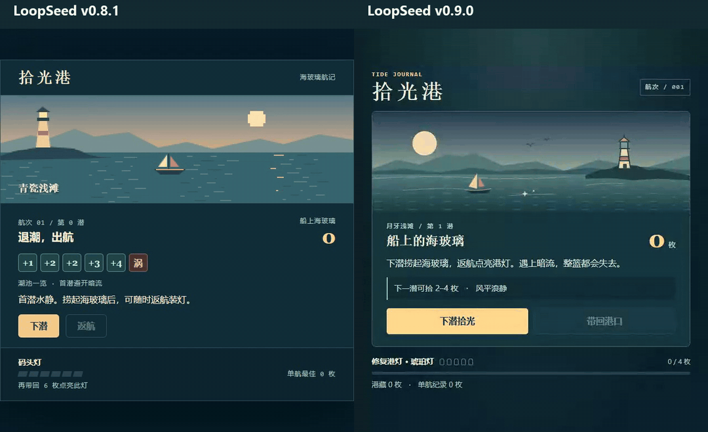

# One vision, two versions of LoopSeed

Two fresh Codex sessions received the same unmodified, offline game and the same prompt, `$loopseed 让玩家打完第一局，就想再开一局。` Both found that the original repeated the same dives and gave a banked catch no value on the next voyage. Both made a further product change after their first playable edit.

[Download the original and both playable HTML builds](playable-builds.zip)

| | v0.8.1 | v0.9.0 |
|---|---|---|
| First playable edit | Exposed the tide pool and its hazards. Returning glass fills the harbor lamp and preserves a best score. | Made each dive's risk visible and let banked glass restore five harbor lamps. |
| What the agent did next, without another prompt | Added a next-tide forecast to the result screen, including the largest catch and the number of hazards. | Added a safe and a risky route at settlement. After trying the loop, the agent noticed that the player had to calculate when to bank and put the specific lamp reward on the return button. |
| What we operated | Banked a catch, saw the next tide's forecast, and took the single replay action to 琥珀礁. | The first four pieces changed the button to **返航点亮琥珀灯**. After banking, the lighthouse lit. Choosing 青螺礁 offered 5–8 pieces and a 1-in-4 first-dive risk. 白沙湾 offered a safe first dive. |
| Run ended | 286.6 seconds, after browser checks and a report. | 357.9 seconds, with a saved handoff describing the changes and the missing first-time player feedback. |

## How the comparison was run

- Each checkout started with the same HTML bytes. Each used its own project-local LoopSeed skill, a fresh Git repository, Codex CLI 0.169.0, `gpt-6.2-astra` at low reasoning effort, and a 360-second wall-clock allowance. Neither session received a follow-up prompt. The recorded comparison uses the final default skill text. An earlier development run with provisional wording also reached its time limit.
- At approximately 122 and 198 seconds the baseline run wrote its first build and added its forecast. The candidate wrote its first build at 127 seconds, revised the route choices at 236 seconds and updated the banking affordance at 310 seconds. The baseline attempted a separate critic in the ephemeral CLI session and that worker failed to start.
- A separate Playwright operator played the saved builds offline in clean Chrome 157 contexts. The recording uses a fixed random seed of 7 for both builds and the same first-dive and bank inputs. In the second voyage the operator takes the baseline's offered route and the candidate's risky route. Separate checks covered the safe route, losing a catch, restarting, preserving banked progress on reload and a 390-pixel-wide viewport. Both games completed these checks without a page error. The ZIP preserves the exact HTML bytes and includes file hashes.
- This is one model run per recorded version and scripted browser input. A player's willingness to start another voyage remains unmeasured.

## Recovery and scoped work

A separate real Codex session fixed a save/load bug, passed a file-backed round trip and exited without creating a vision handoff. Another session received an explicit owner stop and preserved the existing observation with status `ABORTED`.

The Windows Codex app server also loaded a clean installation of the plugin from a local test marketplace. A local transport captured the context passed to a fresh turn. The registered SessionStart hook delivered the saved vision when active and supplied no continuation after the stop. The plugin remained trusted on the next session. These checks exercise the host and hook commands independently of the game runs.
